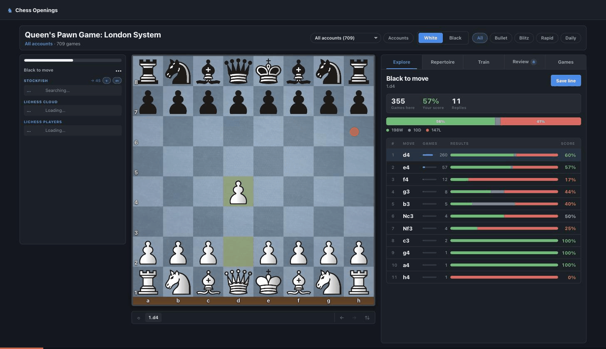
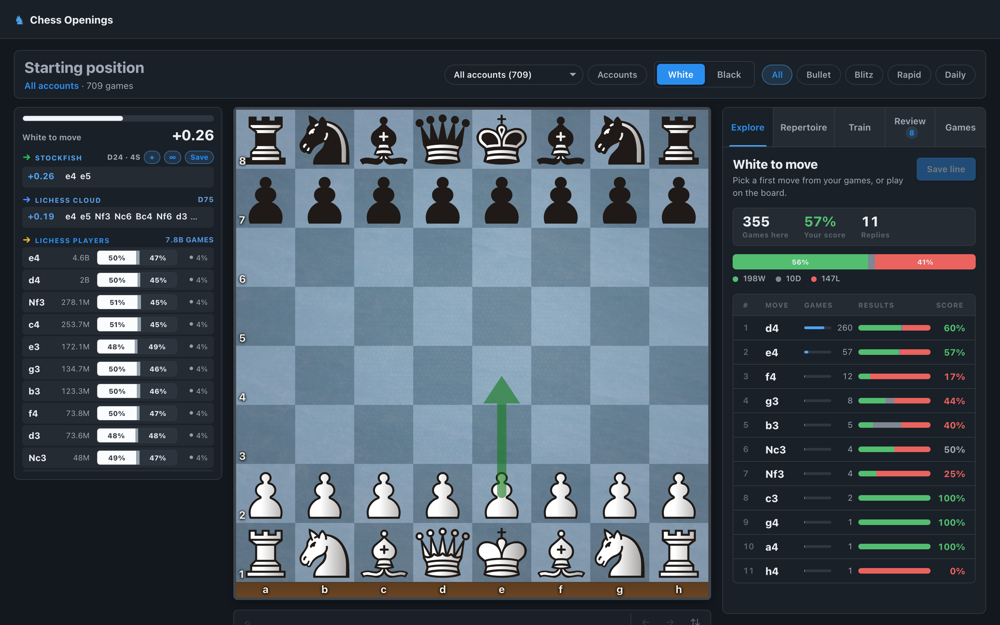
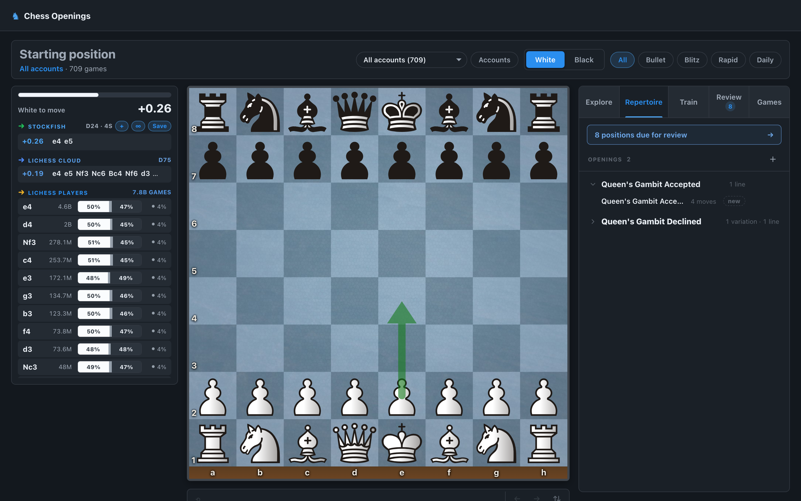
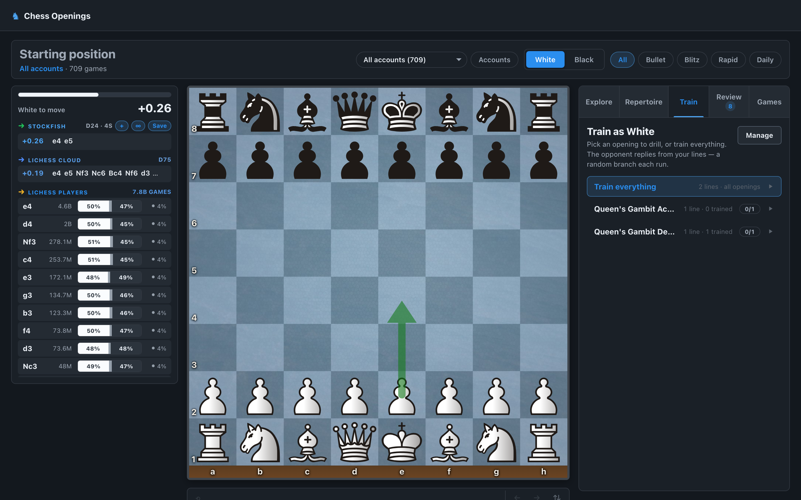
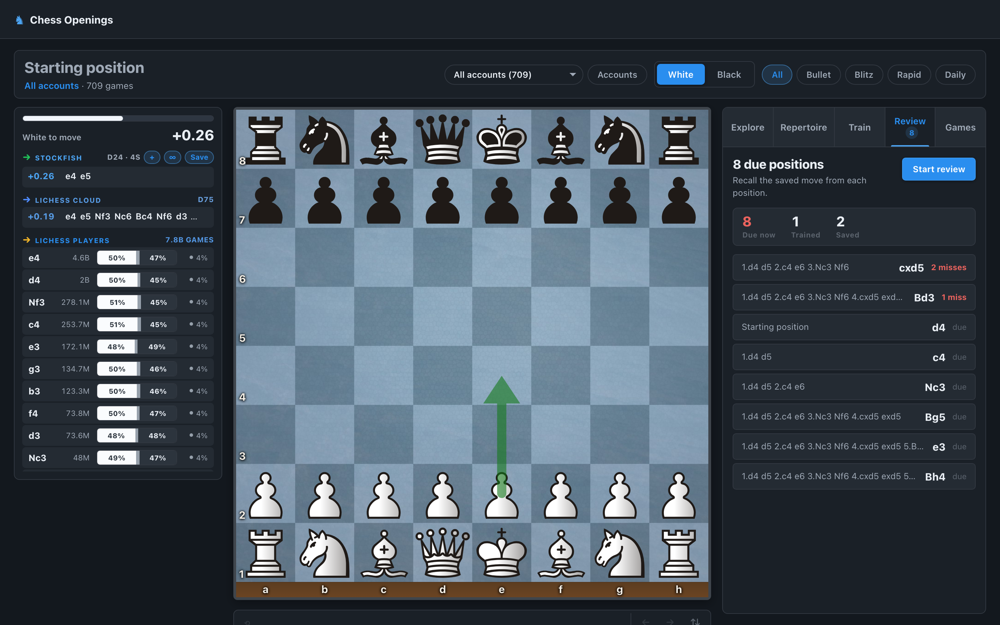
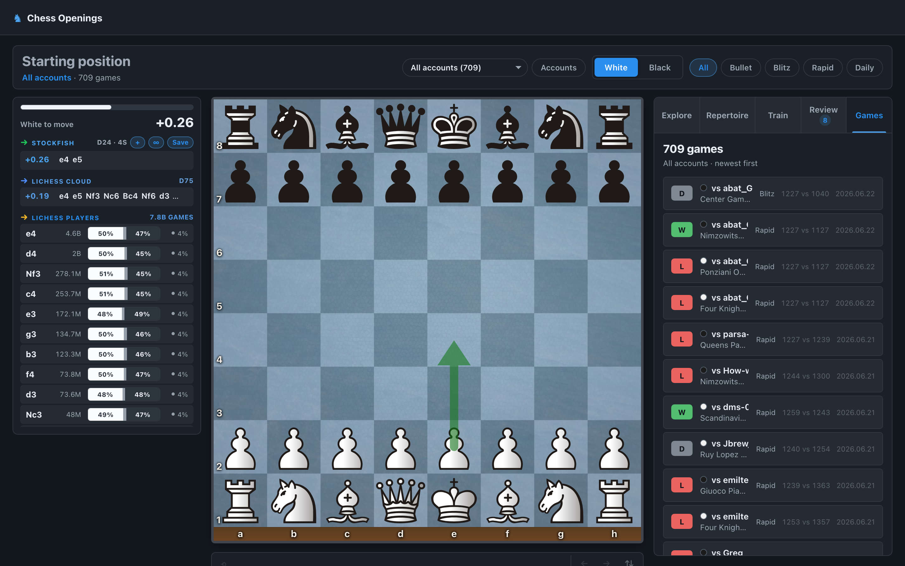

# Chess Openings Trainer

A full-stack web app for building, drilling, and analyzing chess opening repertoires. You import your real games from Chess.com and Lichess, explore the openings you actually play as an interactive move tree, build a personal repertoire, and drill it against spaced-repetition practice — with optional Stockfish analysis and the Lichess opening explorer wired in.

Built with a **FastAPI + SQLite** backend and a **React 19 + Vite** frontend, with an interactive board powered by [chessground](https://github.com/lichess-org/chessground) and [chess.js](https://github.com/jhlywa/chess.js).

> The app runs entirely on your machine. Your imported games live in a local SQLite database — nothing is uploaded anywhere.



---

## Screenshots

| Explore | Repertoire | Train |
|---------|------------|-------|
|  |  |  |

| Review (spaced repetition) | Games |
|----------------------------|-------|
|  |  |

---

## Features

- **Game import** — pull your full game history from Chess.com and Lichess by username, deduplicated and stored locally. Track multiple accounts and filter views per account.
- **Opening explorer** — every imported game is folded into an interactive opening tree. Walk the moves you actually play, see win/draw/loss stats and frequencies at each position, and find where your repertoire leaks.
- **Repertoire builder** — save lines per color, organize them into folders, tag them (`main`, `alternative`, `trap`, `sideline`), and annotate positions with notes.
- **Practice / drilling** — rehearse your repertoire move by move; the trainer walks the tree and checks your answers.
- **Engine analysis** — optional local Stockfish integration for live evaluations and best-move hints.
- **Play against Stockfish** — play any position (from the explorer, one of your games, or a pasted FEN). With seven pieces or fewer every move gets an exact verdict from the Lichess tablebase.
- **Lichess Practice library** — all 32 practice sets imported once and playable against the engine, with each position's goal checked for you.
- **Your own mistakes** — Stockfish goes through your newest games (automatically after each sync) and turns each mistake into a one-move exercise: find something better than you played, then play the position on. A report shows where your mistakes cluster and starts puzzles on that theme.
- **Lichess puzzles** — one at a time on any theme and difficulty; missed puzzles are kept to retry.
- **chess.com round trip** — a bookmark opens the chess.com game you are looking at in the app, and the review links back.
- **Lichess integration** — the cloud opening explorer and a "Lichess players" lookup, using the official Lichess API.
- **Chrome extension for lichess.org** — Lichess plus your app on top: your Stockfish in Lichess's own engine bar, eval bar and Practice; a My games tab in Lichess's explorer with your chess.com history; your repertoire, your game and your mistakes in the analysis board's left column; your mistakes on the puzzle page; your app's board colours. Everything switches off while any game is in progress, and a self-check reports any feature a Lichess update moved. See [extension/README.md](extension/README.md).
- **Offline opening recognition** — an embedded ECO database names openings from their move sequence without any network call.

## Tech stack

| Layer    | Tools |
|----------|-------|
| Backend  | Python, FastAPI, Uvicorn, SQLite, [python-chess](https://python-chess.readthedocs.io/), httpx |
| Frontend | React 19, Vite, chessground, chess.js, axios |
| Engine   | Stockfish (optional, auto-detected) |
| Tests    | pytest (backend), Vitest + Testing Library, Playwright (frontend) |

## Architecture

```
openings/
├── backend/                 FastAPI service (default :8001)
│   ├── main.py              app + REST API routes, static frontend serving
│   ├── database.py          SQLite schema, migrations, connection handling
│   ├── opening_tree.py      builds/caches the opening move tree from games
│   ├── game_import.py       Chess.com / Lichess game importers
│   ├── repertoire_repository.py, account_game_repository.py, ...
│   ├── live_engine.py       Stockfish process management & evaluation
│   ├── eco_openings.py      offline move-sequence → opening-name recognizer
│   └── tests/               pytest suite
├── frontend/                React + Vite single-page app (dev :5174)
│   └── src/
│       ├── OpeningsApp.jsx  shell + tab routing
│       ├── components/tabs/ Explore, Games, Practice, Repertoire, Review
│       ├── components/      Board, EnginePanel, AccountsModal, ...
│       └── api.js           backend client
├── start.sh / stop.sh       self-contained run scripts
└── requirements.txt
```

In production the FastAPI backend serves the built frontend, so the whole app runs from a single port (`:8001`). In dev mode the frontend runs on Vite's dev server (`:5174`) with hot-module reload and proxies API calls to the backend.

The SQLite database is created and migrated automatically on first launch — no manual setup needed.

## Getting started

### Prerequisites

- **Python 3.10+**
- **Node.js 18+** and npm
- **Stockfish** *(optional)* — for engine analysis. Without it, the explorer, repertoire, and training all still work; only engine evaluation is unavailable. Install via `brew install stockfish` (macOS) or your package manager, or set `STOCKFISH_PATH` to a binary.

### Run it

The `start.sh` script is self-contained: it creates a Python virtualenv, installs backend and frontend dependencies, builds the frontend, and launches the app.

```bash
# Production mode — builds the frontend and serves everything on :8001
./start.sh
# → open http://localhost:8001

# Dev mode — backend on :8001, Vite HMR frontend on :5174
./start.sh --dev
# → open http://localhost:5174

# Stop the app
./stop.sh
```

### Manual setup

If you prefer to run the pieces yourself:

```bash
# Backend
python3 -m venv venv
source venv/bin/activate
pip install -r requirements.txt
uvicorn backend.main:app --host 127.0.0.1 --port 8001

# Frontend (in a second terminal)
cd frontend
npm install
npm run dev        # http://localhost:5174
```

## Tests

```bash
# Backend
source venv/bin/activate
pytest backend/tests

# Frontend
cd frontend
npm test           # Vitest unit/component tests
npm run test:e2e   # Playwright end-to-end tests
```

## Configuration

| Environment variable | Default | Purpose |
|----------------------|---------|---------|
| `CHESS_DB_PATH`      | `./chess_review.db` | Location of the SQLite database file |
| `STOCKFISH_PATH`     | auto-detected | Path to the Stockfish binary for engine analysis |

The Lichess opening explorer and player lookups require a Lichess API token, configured in-app via the Accounts modal.

## License

Released under the [GNU Affero General Public License v3.0 or later](LICENSE).

The board uses Lichess's chessground library and several Lichess assets (pieces, sounds), each under its own licence. See [CREDITS.md](CREDITS.md). The Maestro piece set is licensed for non-commercial use only.
